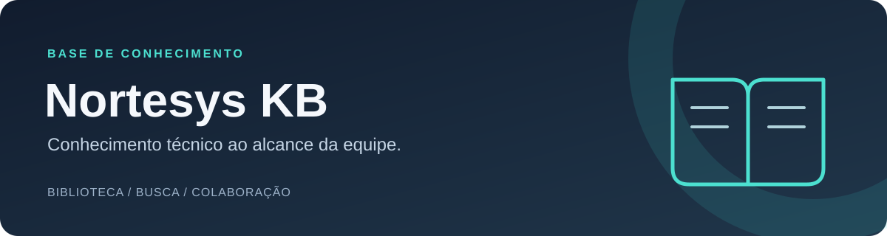

<p align="center">
  
</p>

<p align="center">
  <strong>Uma base de conhecimento para transformar experiência em soluções reutilizáveis.</strong><br />
  Artigos, procedimentos e respostas organizados para o dia a dia da equipe Nortesys.
</p>

<p align="center">
  <a href="#o-que-a-base-oferece">Recursos</a> ·
  <a href="#começar-localmente">Começar</a> ·
  <a href="docs/README.md">Documentação</a> ·
  <a href="CONTRIBUINDO.md">Contribuir</a>
</p>

## O que a base oferece

- **Biblioteca técnica:** soluções, tutoriais, guias e perguntas frequentes, com categorias, tags e filtros.
- **Busca:** pesquisa textual com Fuse.js, equivalências terminológicas, filtros combinados e exibição progressiva dos resultados; permite explorar artigos só pelos filtros.
- **Diagnóstico guiado:** perguntas de triagem para NF-e/NFC-e, impressão, acesso e instalação, com pesquisa em artigos disponíveis e sugestões de conteúdos relacionados.
- **Edição no navegador:** Markdown com prévia, modelos de conteúdo, rascunhos, revisão, arquivamento e histórico de versões.
- **Imagens privadas:** envio de PNG, JPEG e WebP, validação do arquivo e leitura autenticada conforme o acesso ao artigo.
- **Anexos PDF privados:** documentos de até 3 MB vinculados a artigos, com download autenticado. Exige migração 005 aplicada no banco escolhido.
- **Área pessoal:** favoritos e artigos acessados recentemente.
- **Registro técnico:** gerador local de registros de atendimento padronizados, com botão para copiar, sem persistir dados de clientes.
- **Administração:** contas individuais, perfis de acesso e consulta de ações administrativas.
- **Interface adaptável:** temas claro/escuro, navegação móvel, atalhos de busca e transições que respeitam a preferência por movimento reduzido.

### Perfis de acesso

| Perfil | Uso principal |
| --- | --- |
| Leitor | Consultar conteúdo disponível, pesquisar e salvar favoritos |
| Editor | Recursos de leitura e gestão editorial de artigos e imagens |
| Administrador | Gestão editorial, contas, permissões e auditoria |

O controle é feito também no servidor. Não há cadastro público de contas.

## Tecnologias

| Camada | Implementação |
| --- | --- |
| Aplicação | Next.js 16, App Router, React 19 e TypeScript |
| Interface | Tailwind CSS 4 e CSS do projeto |
| Conteúdo | Markdown, frontmatter, Zod e editor com prévia |
| Pesquisa | Fuse.js |
| Banco | PostgreSQL no Neon |
| Arquivos enviados | Vercel Blob privado e processamento com Sharp |
| Validação | ESLint, TypeScript, testes Node/tsx e PostgreSQL em memória com PGlite |

## Começar localmente

Requisitos: Node.js **20.9 ou superior**, npm e um banco Neon para desenvolvimento.

```bash
git clone https://github.com/VictorAms12/nortesys-kb.git
cd nortesys-kb
npm ci
```

Copie `.env.example` para `.env.local` e preencha `DATABASE_URL` com a conexão do banco de desenvolvimento. Para uploads, configure também um store Blob privado, conforme o [guia de configuração](docs/guias/configuracao.md).

Prepare o banco e a primeira conta:

```bash
npm run db:migrar
# Aplique db/004_imagens.sql inteiro no SQL Editor do banco escolhido.
npm run usuario:adicionar -- admin "Administrador" administrador
npm run dev
```

Abra **http://localhost:3000**. A criação da conta imprime a senha inicial uma única vez.

> `db:migrar` aplica somente as migrações **001–003**. A **004** contém uma função e um trigger e deve ser executada inteira, incluindo `BEGIN` e `COMMIT`. O build não aplica migrações.

Sem `DATABASE_URL`, a página de login indica acesso indisponível. Isso permite conferir a interface, mas não utilizar os fluxos autenticados.

## Comandos do dia a dia

Execute na raiz do repositório. No PowerShell, use `npm.cmd` se a política local impedir `npm.ps1`.

| Comando | Finalidade |
| --- | --- |
| `npm run dev` | Servidor de desenvolvimento |
| `npm run verificar:revisao` | Estrutura, documentação, conteúdo, testes, lint e tipos, sem acessar serviços reais |
| `npm run build:revisao` | Build de produção isolado em `build/`, sem copiar arquivos `.env` nem uploads locais |
| `node tests/testar-build-revisao.mjs build/revisao-IDENTIFICADOR` | Teste HTTP do build isolado; use o caminho impresso pelo comando anterior |
| `npm run build` | Build normal, usando a configuração do ambiente |
| `npm start` | Servir um build normal já gerado |
| `npm run validar:artigos` | Validar os arquivos Markdown da biblioteca |
| `npm run testar:imagens` | Testar imagens com banco em memória e armazenamento simulado |
| `npm run db:verificar` | Consultar o banco definido em `.env.local` |

Os testes isolados não substituem a validação de login, edição e upload no Preview com os serviços reais. Os comandos `db:*` e `usuario:*` acessam o banco configurado; consulte os [detalhes de configuração](docs/guias/configuracao.md).

## Estrutura do projeto

```text
src/
  app/          Páginas, layouts e rotas de API do Next.js
  components/   Interface, navegação, editor e formulários
  lib/          Autenticação, conteúdo, busca, banco e imagens
  types/        Tipos compartilhados
config/         Categorias e configuração da base
content/        Artigos Markdown versionados e modelos
db/             Migrações SQL numeradas
public/         Arquivos estáticos
scripts/        Validação, build e ferramentas administrativas
tests/          Testes e verificação HTTP do build
docs/
  guias/        Configuração e publicação atuais
  relatorios/   Registros de revisão técnica
  historico/    Documentação das etapas anteriores
```

`build/`, `.next/`, `.local/`, configurações da Vercel e arquivos `.env` locais ficam fora do Git. Materiais antigos do piloto foram preservados em `.local/piloto/` no computador de desenvolvimento.

## Publicação e manutenção

Use uma branch de trabalho para alterações, valide no Preview e integre na `main` após os checks. O destino de publicação depende da configuração do projeto na Vercel.

**Production, Preview e Development precisam das configurações correspondentes.** Uma variável limitada a uma branch de Preview não configura automaticamente a produção. O [guia de deploy](docs/guias/deploy.md) reúne migrações, variáveis e verificação após publicar.

Leia também:

- [Mapa da documentação](docs/README.md)
- [Arquitetura e fluxo dos dados](docs/arquitetura.md)
- [Como contribuir](CONTRIBUINDO.md)
- [Relatório de revisão, desempenho e animações](docs/relatorios/revisao-polimento-performance.md)

Credenciais, capturas de clientes e dados pessoais não devem entrar no repositório. O scanner do projeto ajuda a encontrar padrões suspeitos; a revisão do material continua necessária.
