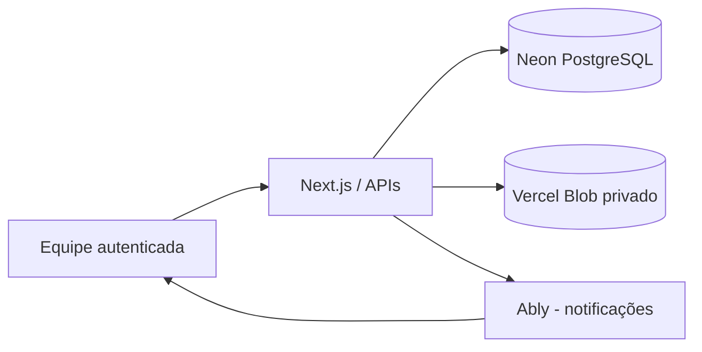

<p align="center">
  
</p>

<h1 align="center">Nortesys KB</h1>

<p align="center">
  <strong>Conhecimento técnico organizado. Atendimento mais ágil. Soluções que ficam.</strong>
</p>

<p align="center">
  Plataforma interna para centralizar procedimentos, compartilhar experiências e apoiar o suporte técnico da Nortesys — da pesquisa de artigos à comunicação entre integrantes da equipe.
</p>

<p align="center">
  <a href="#visão-geral">Visão geral</a> ·
  <a href="#funcionalidades">Funcionalidades</a> ·
  <a href="#começando">Começar</a> ·
  <a href="#banco-de-dados-e-migrações">Banco de dados</a> ·
  <a href="#desenvolvimento-e-testes">Testes</a> ·
  <a href="#documentação">Documentação</a>
</p>

---

## Visão geral

O **Nortesys KB** é uma base de conhecimento e colaboração voltada ao cotidiano do suporte. Reúne artigos técnicos, pesquisa, ferramentas de atendimento, administração de conteúdo e chat interno em uma interface única, responsiva e com controle de acesso por perfil.

| Para a equipe de suporte | Para quem mantém a base |
| --- | --- |
| Encontrar soluções e procedimentos com rapidez | Criar, revisar, versionar e organizar artigos |
| Consultar diagnósticos guiados e conteúdos relacionados | Administrar usuários, permissões e auditoria |
| Padronizar registros de atendimento | Gerenciar imagens e PDFs privados |
| Trocar mensagens no chat geral ou privado | Evoluir a aplicação com testes e revisão por PR |

> **Escopo:** aplicação interna com acesso autenticado. O projeto não possui cadastro público, e informações de clientes ou credenciais não devem ser incluídas em artigos, mensagens ou commits.

## Funcionalidades

### Base de conhecimento

- **Artigos estruturados:** soluções, tutoriais, guias e FAQs, organizados por categorias e tags.
- **Busca inteligente:** pesquisa com Fuse.js, sinônimos de termos técnicos, filtros combinados e exploração mesmo sem digitar uma palavra-chave.
- **Diagnóstico guiado:** fluxos de triagem para NF-e/NFC-e, impressão, acesso e instalação, com sugestões de leitura — sem substituir a análise do profissional.
- **Leitura contextual:** conteúdos relacionados por tags, termos e códigos de erro, além de favoritos e histórico de leituras recentes.

### Conteúdo e administração

- **Editor Markdown:** prévia, modelos por tipo de artigo, rascunhos, publicação, arquivamento e versões anteriores.
- **Gestão editorial:** pesquisa administrativa, filtros, slug automático, duplicação e comparação/recuperação de versões.
- **Imagens privadas:** PNG, JPEG e WebP, com validação, armazenamento no Vercel Blob e acesso autorizado pelo servidor (até **2 MiB** por arquivo).
- **Anexos PDF privados:** visualização e download autenticados, vinculados aos artigos (até **3 MiB** por arquivo).
- **Administração e auditoria:** contas individuais, papéis de acesso e consulta a eventos relevantes, sem registrar conteúdo de mensagens ou segredos.

### Comunicação interna

O chat permite conversar no **canal geral** e em **conversas privadas**, com:

- Histórico persistido, pesquisa de mensagens e contagem de não lidas.
- Indicadores de digitação e presença aproximada (**online**, **ausente**, **offline**).
- **Responder** a uma mensagem, exibindo a referência original.
- **Apagar para mim**, sem alterar o histórico dos demais participantes.
- **Apagar para todos**, disponível ao autor da mensagem.
- **Limpar conversa**, ocultando mensagens anteriores apenas para a conta atual.
- Atualização em tempo real com Ably e consulta periódica como alternativa quando o serviço não está disponível.

As APIs verificam autenticação e participação nas conversas privadas. Eventos em tempo real não transportam o texto das mensagens privadas.

### Ferramentas e experiência

- **Gerador de registro técnico:** formulário padronizado com prévia e cópia, sem persistir os dados digitados.
- **Navegação unificada:** sidebar responsiva, áreas de suporte e administração de acordo com as permissões.
- **Interface adaptável:** temas claro e escuro, estados de carregamento, navegação por teclado e respeito à preferência por movimento reduzido.

## Perfis de acesso

| Perfil | Permissões principais |
| --- | --- |
| **Leitor** | Consultar artigos disponíveis, pesquisar, usar recursos de leitura e o chat |
| **Editor** | Recursos de leitura e criação/gestão editorial de artigos e anexos |
| **Administrador** | Gestão editorial, contas, permissões e auditoria |

As permissões não dependem apenas do menu: são verificadas também nas rotas e APIs do servidor.

## Tecnologias e arquitetura

| Camada | Tecnologias |
| --- | --- |
| Aplicação | **Next.js 16** (App Router), **React 19**, **TypeScript** |
| Interface | **Tailwind CSS 4**, CSS do projeto |
| Conteúdo e busca | Markdown, Zod, gray-matter, **Fuse.js** |
| Dados e autenticação | **PostgreSQL (Neon)**, contas e sessões persistidas |
| Imagens e anexos | **Vercel Blob privado**, Sharp |
| Chat em tempo real | **Ably** (eventos) + Neon (histórico, permissões e presença) |
| Qualidade | ESLint, testes Node/tsx, TypeScript e **PGlite** |
| Publicação e CI | **Vercel** e **GitHub Actions** |



Os artigos podem existir como arquivos Markdown em `content/` ou no banco. Quando existe uma versão correspondente no banco, ela prevalece, respeitando o estado do artigo e as permissões. Consulte a [arquitetura detalhada](docs/arquitetura.md).

## Começando

### Pré-requisitos

- **Node.js 20.9+** e npm.
- Uma conexão **Neon/PostgreSQL de desenvolvimento** (não use o banco de produção).
- Para testar uploads, um store **Vercel Blob privado** configurado.
- Para notificações instantâneas do chat, uma chave **Ably** de desenvolvimento/Preview.

### 1. Clonar e instalar

```bash
git clone https://github.com/VictorAms12/nortesys-kb.git
cd nortesys-kb
npm ci
```

### 2. Preparar o ambiente

Copie `.env.example` para `.env.local` e edite os valores no seu computador.

**PowerShell (Windows):**

```powershell
Copy-Item .env.example .env.local
```

**Linux/macOS:**

```bash
cp .env.example .env.local
```

| Variável | Finalidade |
| --- | --- |
| `DATABASE_URL` | Conexão com o Neon/PostgreSQL, com `sslmode=require`; necessária para login, conteúdo e chat |
| `BLOB_STORE_ID` | Identificação do store privado no fluxo OIDC do Vercel Blob |
| `BLOB_READ_WRITE_TOKEN` | Alternativa para integração Blob com token de servidor |
| `ABLY_API_KEY` | Chave privada do Ably para eventos em tempo real; sem ela, o chat usa consultas periódicas |

O fluxo de Blob depende da autenticação válida da integração: o identificador do store, sozinho, não fornece credenciais OIDC. **Nunca use `NEXT_PUBLIC_` nessas variáveis nem comite arquivos `.env`.** As sessões já ficam no PostgreSQL; `KB_SESSION_SECRET` não é necessário.

### 3. Preparar o banco de desenvolvimento

```bash
npm run db:migrar
```

Esse comando aplica apenas as migrações **001 a 003**. Para utilizar todas as funcionalidades, execute também as migrações **004 a 007**, na ordem, no SQL Editor do **banco de desenvolvimento**, conforme a tabela abaixo.

### 4. Criar a primeira conta e iniciar

```bash
npm run usuario:adicionar -- admin "Administrador" administrador
npm run dev
```

Abra **http://localhost:3000**. Guarde a senha inicial exibida pelo comando de criação da conta.

> Sem `DATABASE_URL`, a interface de login pode ser exibida, mas a autenticação fica indisponível. Para detalhes de credenciais, Blob e verificação do banco, consulte o [guia de configuração](docs/guias/configuracao.md).

## Banco de dados e migrações

As migrações ficam em [`db/`](db/) e precisam ser aplicadas **no ambiente correto**, antes de disponibilizar o código que depende delas.

| Arquivo | Recursos | Aplicação |
| --- | --- | --- |
| [`001_auth.sql`](db/001_auth.sql) | Usuários, sessões e login | `npm run db:migrar` |
| [`002_painel.sql`](db/002_painel.sql) | Artigos, versões e auditoria | `npm run db:migrar` |
| [`003_interacoes.sql`](db/003_interacoes.sql) | Favoritos e leituras | `npm run db:migrar` |
| [`004_imagens.sql`](db/004_imagens.sql) | Upload e associação de imagens | SQL Editor, arquivo completo |
| [`005_anexos.sql`](db/005_anexos.sql) | Anexos PDF privados | SQL Editor, arquivo completo |
| [`006_chat.sql`](db/006_chat.sql) | Conversas, mensagens e presença | SQL Editor, arquivo completo |
| [`007_chat_acoes.sql`](db/007_chat_acoes.sql) | Respostas, exclusões e limpeza | SQL Editor, arquivo completo |

**Atenção:**

- `004_imagens.sql` contém função/trigger PL/pgSQL; execute o arquivo inteiro, incluindo a transação.
- `005`–`007` também são aplicadas manualmente. Não presuma que `db:migrar` ou `npm run build` execute essas etapas.
- Ao configurar um novo Preview, Development ou Production, confira o **projeto, branch e endpoint do Neon**, não apenas o nome do banco.
- Em bases já migradas, **verifique o esquema antes de executar qualquer SQL novamente**. Não copie dados de produção para desenvolvimento sem autorização e tratamento adequado.

O procedimento completo está no [guia de configuração](docs/guias/configuracao.md) e no [guia de deploy](docs/guias/deploy.md).

## Desenvolvimento e testes

Execute os comandos na raiz do projeto:

| Comando | O que faz |
| --- | --- |
| `npm run dev` | Inicia o servidor de desenvolvimento |
| `npm run verificar:revisao` | Verifica estrutura, links, conteúdo, testes, lint e tipos sem serviços reais |
| `npm run build:revisao` | Produz um build de revisão isolado, sem copiar credenciais locais |
| `npm run testar:chat` | Testa fluxos e regras do chat com ambiente simulado |
| `npm run testar:chat-acoes` | Testa respostas, exclusões e limpeza de conversa |
| `npm run testar:anexos` | Testa anexos e validações relacionadas |
| `npm run testar:ferramentas` | Testa ferramentas de atendimento |
| `npm run validar:artigos` | Valida os artigos Markdown |
| `npm run db:verificar` | Consulta o banco definido em `.env.local` |
| `npm run build` / `npm start` | Compila e inicia a aplicação para produção |

Fluxo recomendado antes de abrir um Pull Request:

```bash
npm run verificar:revisao
npm run build:revisao
```

Para validar o build isolado por HTTP, use o comando abaixo com o **diretório que o build imprimir**:

```bash
node tests/testar-build-revisao.mjs build/revisao-IDENTIFICADOR
```

O GitHub Actions executa `npm run verificar:revisao` nos PRs direcionados à `main`. Testes simulados não substituem a validação manual do Preview com autenticação, Neon, Blob e Ably reais. No Windows, caso o PowerShell bloqueie `npm.ps1`, utilize `npm.cmd`.

## Estrutura do repositório

```text
nortesys-kb/
├── src/
│   ├── app/           # Páginas, layouts e rotas de API
│   ├── components/    # Interface, editor, sidebar e chat
│   ├── lib/           # Regras de negócio, auth e integrações
│   └── types/         # Tipos compartilhados
├── content/           # Markdown e modelos de artigos
├── config/            # Categorias e configurações
├── db/                # Migrações SQL numeradas
├── scripts/           # Validações e administração
├── tests/             # Testes automatizados
├── public/            # Arquivos estáticos
└── docs/              # Guias, arquitetura e histórico
```

Diretórios locais como `.next/`, `build/`, `.local/` e arquivos de ambiente não devem entrar no Git.

## Publicação e manutenção

O fluxo de entrega é **branch → Pull Request → GitHub Actions / Vercel Preview → validação → `main`**.

1. Desenvolva em uma branch a partir da `main`.
2. Execute as verificações e documente novas variáveis, migrações e impactos.
3. Confira os checks e teste as funcionalidades afetadas no Preview.
4. Antes de integrar, garanta que o banco e as integrações do ambiente de destino estão preparados.
5. Faça merge somente após revisão e validação; confirme o commit publicado na Vercel.

**Production, Preview e Development têm configurações próprias.** Nunca assuma que as variáveis ou migrações de um ambiente existem automaticamente em outro. Veja [publicação na Vercel](docs/guias/deploy.md) e [orientações para contribuir](CONTRIBUINDO.md).

## Documentação

| Documento | Consulte para |
| --- | --- |
| [Guia de configuração](docs/guias/configuracao.md) | Ambiente local, autenticação, Neon e armazenamento |
| [Guia de deploy](docs/guias/deploy.md) | Preparação e diagnóstico de deployments |
| [Arquitetura](docs/arquitetura.md) | Organização, autorização e fluxos de dados |
| [Contribuição](CONTRIBUINDO.md) | Branches, conteúdo técnico, revisão e segurança |
| [Histórico da Fase 7G](docs/historico/FASE-7G-CHAT-AUDITORIA.md) | Chat, presença, auditoria e testes |
| [Ações em mensagens — 7G.3](docs/historico/FASE-7G3-ACOES-MENSAGENS.md) | Responder, apagar e limpar conversas |
| [Mapa completo da documentação](docs/README.md) | Índice de guias e documentos anteriores |

> **Segurança e privacidade:** use exemplos fictícios nos artigos e nos testes. Nunca publique chaves, cookies, senhas, XMLs reais com dados de clientes ou capturas com informações pessoais no repositório.

---

<p align="center">
  <strong>Nortesys KB</strong> · Conhecimento compartilhado para um suporte mais consistente.
</p>
