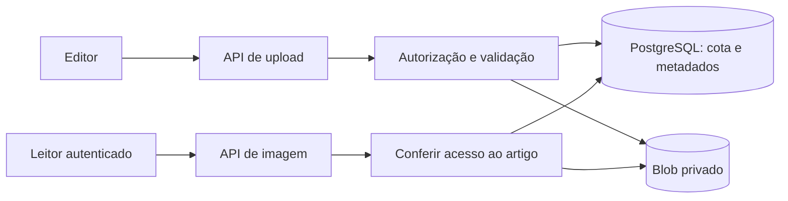

# Arquitetura

## Organização

A aplicação usa o App Router do Next.js. `src/app/` contém páginas, layouts, limites de carregamento/erro e APIs. `src/components/` reúne a interface; `src/lib/` concentra conteúdo, autenticação, autorização e integrações. As regras do banco ficam nas migrações de `db/`.

`scripts/` contém ferramentas operacionais e de validação. `tests/` concentra as suítes, incluindo o teste HTTP do build. A documentação atual está em `docs/guias/`; registros anteriores ficam em `docs/historico/`.

## Conteúdo e pesquisa

Artigos podem vir dos arquivos Markdown de `content/` ou do PostgreSQL. O registro no banco tem precedência sobre a cópia local, inclusive quando está arquivado ou indisponível para o perfil. Rascunhos não são exibidos a leitores.

A leitura e a validação do Markdown acontecem no servidor. A pesquisa usa um índice com Fuse.js e filtros no cliente; a consulta adiada e a renderização progressiva evitam reconstruir todos os cartões a cada tecla. A biblioteca ainda é carregada para montar o índice: não há busca remota paginada nesta versão.

O editor salva artigos e versões no banco. Favoritos e leituras recentes são associados à conta. Edições de conteúdo que referenciam imagens passam pelo trigger de associação na mesma transação.

## Sessão e permissões

A autenticação utiliza contas no PostgreSQL, hashes de senha e sessões opacas com cookies protegidos. As rotas conferem o perfil necessário e a origem das operações de escrita. O menu ajuda a navegação; a autorização efetiva ocorre no servidor.

`sessaoAtual` e o carregamento de artigos usam cache do React durante a renderização da requisição, evitando consultas repetidas entre layout, página e metadados. Esse cache não compartilha sessões entre usuários ou requisições.

## Upload e leitura de imagens

O upload valida formato, assinatura, tamanho e decodificação; normaliza os bytes antes de gravar. Um UUID identifica a imagem e seu caminho privado. O navegador recebe uma URL da aplicação, nunca credenciais do armazenamento.

O vínculo com o artigo é exclusivo e preservado para o histórico. Falhas parciais registram estado e tentam compensar a gravação do objeto. Banco e Blob não compartilham uma transação distribuída; interrupções podem exigir reconciliação manual.

## Interface e validação

As animações usam CSS, com preferência por movimento reduzido. Formulários mostram envio em andamento e evitam submissões duplicadas. A navegação móvel controla foco e rolagem do fundo.

As suítes cobrem conteúdo, busca, segurança, usuários, formulários, imagens e regressões. PGlite executa as regras SQL de imagens em memória; o armazenamento é simulado. O build isolado e seu teste HTTP complementam esses checks. Os fluxos autenticados com serviços externos e a aparência final devem ser conferidos no deployment.

## Organização das consultas do chat (Fase 6 de engenharia)

A interface histórica `src/lib/chat-sql.ts` continua exportando os mesmos identificadores para evitar alterar rotas e testes. As consultas SQL parametrizadas foram organizadas em `src/lib/chat-sql/conversas.ts`, `mensagens.ts` e `imagens.ts`; o banco continua sendo a única fonte de autorização e histórico. Testes com PGlite verificam o comportamento sem conectar ao Neon real.
